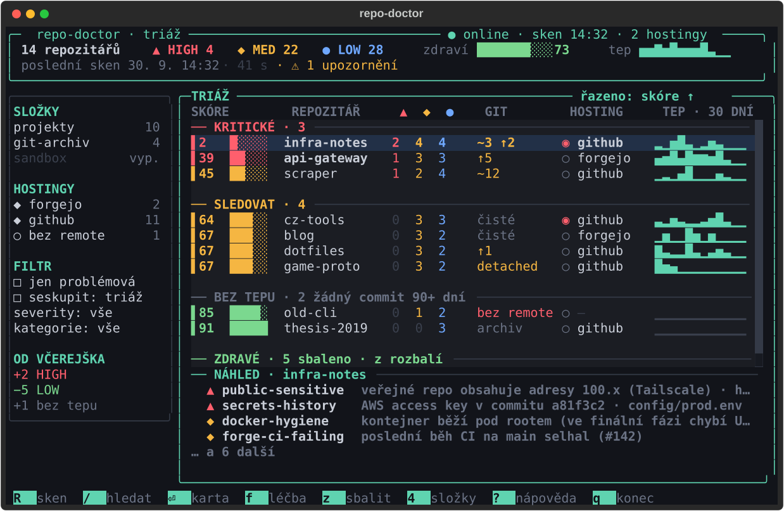

# repo-doctor

TUI pro audit a údržbu git repozitářů. Projde jednu nebo víc tvých složek s repozitáři,
volitelně se připojí k jejich git hostingům (GitHub, Gitea, Forgejo, GitLab), najde
bezpečnostní a hygienické problémy, vyrobí přehledný report a umí **bezpečně** připravit
opravy – vždy jako commity v nové větvi, kterou si zkontroluješ sám.



- **Triáž místo seznamu:** repozitáře roztříděné do pásem KRITICKÉ / SLEDOVAT / BEZ TEPU / ZDRAVÉ,
  skóre 0–100, tep (commity za 30 dní), stav gitu a viditelnost na hostingu.
- **Karta repa** s diagnózou každého nálezu, vysvětlením a ručním postupem opravy.
- **Léčba:** barevný diff navrhovaných oprav, výběr zaškrtávátky a potvrzení dialogem.
- **Funguje úplně offline** a bez hostingů; síťové kontroly (OSV.dev, PyPI, npm, API hostingů) jsou nadstavba.
- **Minimální CLI** pro CI (`repo-doctor scan --report md|json|html`).
- **Novinky 0.3:** samostatná aplikace bez Pythonu a dalších prostředí – balíčky `.deb`, `.rpm`,
  AUR a tarball; aktualizace s aktualizací systému a upozornění na novou verzi v TUI.
- **Novinky 0.2:** kontroly `ci-security` (GitHub Actions), `email-exposure`, `duplicate-clone`,
  `license-compat`, `disk-usage` a `prepush-guard`; SBOM (CycloneDX), **Úklid** místa přes koš,
  **Synchronizace** jen fast-forwardem, plánovaný sken s upozorněním a MCP server pro AI
  asistenty (jen čtení).

## Instalace

repo-doctor je samostatná aplikace pro Linux (x86_64). Má v sobě všechno, co potřebuje, takže
nemusíš řešit Python ani žádné další prostředí. Stačí mít **git**.

### Debian, Ubuntu, Linux Mint, Pop!_OS…

```sh
wget https://github.com/Luquas95/repo-doctor/releases/latest/download/repo-doctor_amd64.deb
sudo apt install ./repo-doctor_amd64.deb
```

### Fedora, RHEL, Rocky, Alma…

```sh
sudo dnf install https://github.com/Luquas95/repo-doctor/releases/latest/download/repo-doctor.x86_64.rpm
```

### Arch Linux

Balíček `repo-doctor-bin` z AUR (např. `yay -S repo-doctor-bin`). Bez AUR helperu stáhni
`PKGBUILD` z [posledního vydání](https://github.com/Luquas95/repo-doctor/releases/latest)
a v jeho složce spusť `makepkg -si`.

### Ostatní distribuce

```sh
wget https://github.com/Luquas95/repo-doctor/releases/latest/download/repo-doctor-linux-x86_64.tar.gz
tar xzf repo-doctor-linux-x86_64.tar.gz && ./repo-doctor/install.sh
```

Aplikace se nainstaluje do `~/.local/lib/repo-doctor` a příkaz `repo-doctor` do `~/.local/bin`
(bez roota). Pokud ho shell nenajde, přidej `~/.local/bin` do `PATH`.

### Ověření

```sh
repo-doctor --version
repo-doctor checks          # seznam dostupných kontrol
```

Pak pokračuj [Rychlým startem](#rychlý-start).

### Volitelné nástroje

Bez nich všechno funguje, jen se příslušná funkce vypne. Stav a co chybí ukáže
`repo-doctor tools` nebo **Nastavení › Volitelné nástroje** v TUI. `repo-doctor tools --install`
(nebo tlačítko „Nainstalovat chybějící“) je po potvrzení doinstaluje:

- systémové balíčky přes správce balíčků distribuce (`apt-get`, `dnf`, `pacman`, `zypper`).
  TUI se na chvíli pozastaví a příkaz poběží viditelně v terminálu přes `sudo`. repo-doctor
  sám root nikdy nezíská.
- `gitleaks` tam, kde ho distribuce nemá (Debian 12, Ubuntu 22.04): stáhne se oficiální
  binárka do `~/.local/share/repo-doctor/tools` a ověří se proti SHA-256 zapsanému
  v repo-doctoru.

| nástroj | k čemu |
|---|---|
| `gitleaks` | rychlejší a přesnější sken tajemství |
| `wl-clipboard` | kopírování cesty do schránky (Wayland) |
| `xdg-utils` | otevření repa na webu |
| `libnotify` (`notify-send`) | upozornění plánovaného skenu na ploše |
| klíčenka Secret Service (GNOME Keyring, KWallet) | ukládání tokenů hostingů. Neinstaluje se, musí běžet v přihlášené relaci |

### Aktualizace

- **.deb / .rpm:** balíček při instalaci přidá podepsaný repozitář repo-doctoru, takže nové
  verze přijdou **s běžnou aktualizací systému** (`sudo apt update && sudo apt upgrade`,
  `sudo dnf upgrade` nebo grafické Aktualizace softwaru).
- **AUR:** s aktualizací přes AUR helper (`yay -Syu`).
- **Tarball:** `repo-doctor update` stáhne nové vydání, ověří jeho podpis a kontrolní
  součet (klíčem zabudovaným v aplikaci) a teprve potom starou verzi vymění. Potřebuje `gpg`.

TUI jednou denně zjistí, jestli vyšla nová verze, a upozorní tě. Vypneš to přes `[updates] check = false`;
v offline režimu se nekontroluje. Ručně: `repo-doctor update --check`.

### Odinstalace

```sh
sudo apt remove repo-doctor          # Debian/Ubuntu (odebere i repozitář repo-doctoru)
sudo dnf remove repo-doctor          # Fedora
sudo pacman -R repo-doctor-bin       # Arch
rm -rf ~/.local/lib/repo-doctor ~/.local/bin/repo-doctor   # tarball
```

Před odinstalací vypni případný plánovaný sken (`repo-doctor schedule remove`). Konfigurace,
cache a historie zůstanou v `~/.config/repo-doctor`, `~/.cache/repo-doctor`
a `~/.local/share/repo-doctor` (resp. podle `XDG_*`) – smaž je ručně, pokud je nechceš.
Tokeny uložené v klíčence odeber v jejím správci.

## Rychlý start

```sh
repo-doctor                 # TUI nad složkami z konfigurace
repo-doctor ~/projekty      # jednorázově jiné složky (nic se neukládá)
```

Při prvním spuštění (bez konfigurace) se otevře **průvodce**: zadáš složky s repozitáři
(Tab doplňuje cestu, Enter přidá), průvodce navrhne hloubku prohledávání podle nalezených
repozitářů a volitelně přidáš git hosting. `Ctrl+S` uloží konfiguraci a spustí první sken.
TUI se pak vždy otevře okamžitě s výsledky posledního skenu a nový sken běží na pozadí.

## Nastavení složek

Obrazovka **Složky** (`4`): `n` přidat (s našeptáváním a kontrolou, že cesta existuje),
`e` upravit hloubku a vylučující vzory, `space` dočasně vypnout, `d` odebrat. U každé složky
vidíš počet nalezených repozitářů. Discovery:

- prochází složku do nastavené hloubky, přeskakuje `node_modules`, `.venv`, `target`, `dist` apod.,
- nevstupuje do vnořených repozitářů (submoduly patří k rodiči),
- symlinky nenásleduje, pokud to složka nepovolí (`follow_symlinks = true`),
- stejné repo dosažitelné dvěma cestami započítá jednou (podle `realpath`).

## Připojení hostingů

Obrazovka **Hostingy** (`5`): `n` přidat, `T` otestovat připojení (ověří token a ukáže,
kolik repozitářů účet vidí), `d` odebrat. Token se v UI nikdy nezobrazí a **nikdy se
neukládá do `config.toml`** – zdroj tokenu je jeden z:

| zdroj | konfigurace |
|---|---|
| systémová klíčenka (Secret Service, výchozí v průvodci) | `token_source = "keyring"` |
| proměnná prostředí | `token_env = "FORGEJO_TOKEN"` |
| příkaz (výstup se ořízne a nikam neloguje) | `token_cmd = "pass show git/forgejo"` |

repo-doctor na hostingu **nic nemění** – stačí tokeny jen pro čtení. Minimální oprávnění:

| hosting | minimální token |
|---|---|
| GitHub | fine-grained token, read-only: *Metadata*, *Contents*, *Actions*, *Dependabot alerts*, *Secret scanning alerts* (klasický token: `public_repo`/`repo` je zbytečně široký – `forges test` upozorní) |
| Gitea / Forgejo | scopes `read:repository`, `read:user`, `read:issue` |
| GitLab | `read_api` (+ `read_repository` pro HTTPS klon) |

### Self-hosted Forgejo za Tailscale

```toml
[[forges]]
name = "domaci-forgejo"
type = "forgejo"
url = "https://git.tailnet-name.ts.net:3000"   # nebo https://100.x.y.z:3000
user = "ja"
token_cmd = "pass show git/forgejo"
ca_bundle = "~/.local/share/certs/homelab-ca.pem"  # pro self-signed certifikát
clone_protocol = "ssh"
```

Pokud Forgejo v Tailscale běží jen na `http://` (šifrování zajišťuje Tailscale), povol jeho
host výslovně v globální konfiguraci – jinak repo-doctor `http` odmítne (fetch, klon i API):

```toml
# Hosty, pro které je povolený nešifrovaný http (např. Forgejo za Tailscale).
allow_http_hosts = ["git.tailnet-name.ts.net"]   # nebo "*.ts.net", "100.64.0.0/10"

[[forges]]
name = "domaci-forgejo"
type = "forgejo"
url = "http://git.tailnet-name.ts.net:3000"
```

Položka je přesný hostname, `*.domena` (jen subdomény), IP adresa nebo síť CIDR, bez portu.
`.repo-doctor.toml` repa volbu nezná – cizí repo si `http` povolit nemůže. Na obrazovce
Hostingy je takový hosting označený „nešifrované spojení, povoleno v allow_http_hosts“;
průvodce prvním spuštěním přidání hosta nabídne s vysvětlením rizika.

Remote typu `ssh://git@git.tailnet-name.ts.net:2222/ja/repo.git` se k hostingu přiřadí podle
hostname (SSH port se může lišit od webového). Fungují i aliasy z `~/.ssh/config`
(`Host forgejo` + `HostName …`). SSH příkaz se bere z proměnné `GIT_SSH_COMMAND`, jinak
z globálního či systémového `core.sshCommand` (i ze souborů vložených přes `[include]`);
nastavení z `includeIf` podle složky repo-doctor nepoužije, takové nastavení je potřeba dát
do proměnné `GIT_SSH_COMMAND` nebo do `~/.ssh/config`. `verify_tls = false` jde nastavit, ale UI před tím varuje –
raději použij `ca_bundle`. Výpadek hostingu (Tailscale vypnutý) nic neblokuje: kontroly
hostingu se označí jako „nedostupné“.

Obrazovka **Vzdálená repa** (`6`) ukáže repozitáře na hostinzích, které nemají lokální klon
(`c` naklonuje po potvrzení do vybrané složky, existující složku nikdy nepřepíše), a opačně
lokální repa bez remote nebo s remote, které hosting nezná.

## Klávesové zkratky

Ovládání jako lazygit / k9s – vše jde jen z klávesnice, myš je volitelná. `?` zobrazí
nápovědu generovanou ze stejných definic, `Ctrl+P` příkazovou paletu (všechny akce
a přechod na libovolné repo podle názvu). Zkratky jdou přemapovat v `config.toml`:

```toml
[keys]
scan_all = "F5"
detail_fix = "ctrl+f"
```

Neplatné nebo kolidující mapování se při startu nahlásí srozumitelnou chybou
(`repo-doctor config validate` ho ověří předem).

**Globální**

| Klávesa | Akce |
|---|---|
| `?` | nápověda |
| `ctrl+p` | příkazová paleta |
| `1` | přehled |
| `2` | karta repa |
| `3` | léčba |
| `4` | složky |
| `5` | hostingy |
| `6` | vzdálená repa |
| `7` | nastavení |
| `8` | export |
| `9` | úklid místa |
| `0` | synchronizace |
| `/` | hledat |
| `R` | sken |
| `r` | sken repa |
| `F` | sken s git fetch |
| `x` | zrušit sken |
| `O` | offline režim |
| `t` | světlé / tmavé téma |
| `q` | zpět |
| `ctrl+q` | konec (zastaví i běžící sken) |

**Pohyb**

| Klávesa | Akce |
|---|---|
| `j` | dolů |
| `k` | nahoru |
| `g` | začátek seznamu |
| `G` | konec seznamu |
| `ctrl+d` | půl stránky dolů |
| `ctrl+u` | půl stránky nahoru |
| `tab` | další panel |
| `shift+tab` | předchozí panel |

**Přehled (triáž)**

| Klávesa | Akce |
|---|---|
| `⏎` | karta |
| `f` | léčba |
| `z` | sbalit |
| `S` | řadit podle sloupce |
| `s` | obrátit řazení |
| `alt+1` | filtr ▲ HIGH |
| `alt+2` | filtr ◆ MED |
| `alt+3` | filtr ● LOW |
| `p` | jen problémová repa |
| `alt+g` | seskupit: triáž / složka / hosting / remote |
| `b` | levý panel |

**Karta repa**

| Klávesa | Akce |
|---|---|
| `f` | léčba |
| `a` | allowlist |
| `o` | editor |
| `w` | web |
| `y` | kopírovat cestu |
| `b` | export SBOM (CycloneDX) |

**Léčba**

| Klávesa | Akce |
|---|---|
| `space` | vybrat |
| `A` | vše |
| `⏎` | potvrdit |

**Složky**

| Klávesa | Akce |
|---|---|
| `n` | přidat |
| `e` | upravit |
| `d` | odebrat |
| `space` | zapnout / vypnout |

**Hostingy**

| Klávesa | Akce |
|---|---|
| `n` | přidat |
| `e` | upravit |
| `d` | odebrat |
| `T` | otestovat připojení |

**Vzdálená repa**

| Klávesa | Akce |
|---|---|
| `c` | naklonovat |
| `v` | přepnout pohled |
| `ctrl+r` | načíst znovu |

**Nastavení**

| Klávesa | Akce |
|---|---|
| `d` | odebrat z allowlistu |

**Export**

| Klávesa | Akce |
|---|---|
| `e` | exportovat |

**Úklid**

| Klávesa | Akce |
|---|---|
| `space` | vybrat |
| `A` | vše / nic |
| `⏎` | do koše |
| `D` | trvale smazat |

**Synchronizace**

| Klávesa | Akce |
|---|---|
| `f` | fetch všech |
| `space` | vybrat |
| `⏎` | rychle dohnat |

**Průvodce prvním spuštěním**

| Klávesa | Akce |
|---|---|
| `ctrl+s` | uložit a skenovat |
| `ctrl+n` | přidat hosting |

**Formulářové dialogy**

| Klávesa | Akce |
|---|---|
| `ctrl+s` | uložit / potvrdit formulář |

## Kontroly

| ID | Kategorie | Severity | Automatická oprava | Síť / hosting |
|---|---|---|---|---|
| [`ci-security`](docs/checks/ci-security.md) | Bezpečnost | MED | ✓ |  |
| [`deps-lockfile-missing`](docs/checks/deps-lockfile-missing.md) | Bezpečnost | MED |  |  |
| [`deps-vulnerable`](docs/checks/deps-vulnerable.md) | Bezpečnost | HIGH |  | síť |
| [`docker-hygiene`](docs/checks/docker-hygiene.md) | Bezpečnost | MED | ✓ |  |
| [`email-exposure`](docs/checks/email-exposure.md) | Bezpečnost | MED | ✓ | síť |
| [`env-committed`](docs/checks/env-committed.md) | Bezpečnost | HIGH | ✓ |  |
| [`prepush-guard`](docs/checks/prepush-guard.md) | Bezpečnost | LOW | ✓ |  |
| [`public-sensitive`](docs/checks/public-sensitive.md) | Bezpečnost | HIGH |  | síť |
| [`secrets-history`](docs/checks/secrets-history.md) | Bezpečnost | HIGH |  |  |
| [`secrets-tree`](docs/checks/secrets-tree.md) | Bezpečnost | HIGH |  |  |
| [`ci-missing`](docs/checks/ci-missing.md) | Údržba | LOW | ✓ |  |
| [`deps-outdated`](docs/checks/deps-outdated.md) | Údržba | LOW |  | síť |
| [`disk-usage`](docs/checks/disk-usage.md) | Údržba | LOW |  |  |
| [`gitignore-incomplete`](docs/checks/gitignore-incomplete.md) | Údržba | MED | ✓ |  |
| [`gitignore-missing`](docs/checks/gitignore-missing.md) | Údržba | MED | ✓ |  |
| [`large-files`](docs/checks/large-files.md) | Údržba | MED |  |  |
| [`license-compat`](docs/checks/license-compat.md) | Údržba | LOW |  | síť |
| [`license-missing`](docs/checks/license-missing.md) | Údržba | LOW | ✓ |  |
| [`precommit-missing`](docs/checks/precommit-missing.md) | Údržba | LOW | ✓ |  |
| [`readme-missing`](docs/checks/readme-missing.md) | Údržba | LOW | ✓ |  |
| [`scan-incomplete`](docs/checks/scan-incomplete.md) | Údržba | LOW |  |  |
| [`default-branch-behind`](docs/checks/default-branch-behind.md) | Stav gitu | LOW |  |  |
| [`detached-head`](docs/checks/detached-head.md) | Stav gitu | LOW |  |  |
| [`duplicate-clone`](docs/checks/duplicate-clone.md) | Stav gitu | LOW |  |  |
| [`no-remote`](docs/checks/no-remote.md) | Stav gitu | MED |  |  |
| [`stale-branches`](docs/checks/stale-branches.md) | Stav gitu | LOW |  |  |
| [`stashes`](docs/checks/stashes.md) | Stav gitu | LOW |  |  |
| [`uncommitted`](docs/checks/uncommitted.md) | Stav gitu | LOW |  |  |
| [`unpushed`](docs/checks/unpushed.md) | Stav gitu | MED |  |  |
| [`unsafe-ownership`](docs/checks/unsafe-ownership.md) | Stav gitu | LOW |  |  |
| [`forge-archived-active`](docs/checks/forge-archived-active.md) | Hosting | MED |  | hosting |
| [`forge-ci-failing`](docs/checks/forge-ci-failing.md) | Hosting | MED |  | hosting |
| [`forge-mirror-drift`](docs/checks/forge-mirror-drift.md) | Hosting | LOW |  | hosting |
| [`forge-no-branch-protection`](docs/checks/forge-no-branch-protection.md) | Hosting | LOW |  | hosting |
| [`forge-security-alerts`](docs/checks/forge-security-alerts.md) | Hosting | HIGH |  | hosting |
| [`forge-stale-prs`](docs/checks/forge-stale-prs.md) | Hosting | LOW |  | hosting |
| [`forge-unknown-remote`](docs/checks/forge-unknown-remote.md) | Hosting | MED |  | hosting |
Podrobnosti ke každé kontrole: `repo-doctor explain <id>` nebo [`docs/checks/`](docs/checks/).

## Konfigurace

`$XDG_CONFIG_HOME/repo-doctor/config.toml` (fallback `~/.config`). Cache je v
`$XDG_CACHE_HOME/repo-doctor/` (poslední sken, odpovědi API), historie skenů v
`$XDG_DATA_HOME/repo-doctor/history/`. Všechno, co nastavíš v TUI, se zapisuje sem a ruční
úpravy (včetně komentářů) zůstávají zachované.

```toml
[[roots]]
path = "~/projekty"
depth = 3
exclude = ["**/archiv/**"]
enabled = true
follow_symlinks = false

[[forges]]
name = "github"
type = "github"
user = "nekdo"
token_source = "keyring"

[checks]
disabled = ["deps-outdated"]
fail_on = "high"          # práh exit kódu CLI

[limits]
large_file_mb = 5
stale_branch_days = 90
stash_days = 30
no_pulse_days = 90        # pásmo BEZ TEPU
stale_pr_days = 30
history_timeout_s = 60    # pak nález scan-incomplete
history_size = 30

[[allowlist]]
hash = "0123456789abcdef" # otisk nálezu (a v kartě repa ho přidá)
reason = "testovací fixtura"

ignore_paths = ["vendor/**"]
ignore_repos = ["*-fork"]
license = "MIT"           # MIT | ISC | BSD-2-Clause | Unlicense
templates_dir = "~/.config/repo-doctor/templates"
[ci]
trusted_action_owners = ["ja"]   # akce z vlastního účtu nemusí být připnuté na SHA (ci-security)

[cleanup]
inactive_days = 60        # disk-usage a předvýběr v Úklidu jen u rep bez commitu tak dlouho
min_mb = 200
# dirs = ["node_modules", ".venv", "target", …]   # regenerovatelné složky

[notify]                  # upozornění plánovaného skenu (jen na změny)
desktop = true            # notify-send, když běží grafická relace
# ntfy_url = "https://ntfy.sh/moje-tema"   # token: token_source = "env"|"cmd"|"keyring"
# email = "ja@example.com"                 # přes lokální sendmail

[schedule]
fetch = false             # true = plánovaný sken nejdřív stáhne novinky (git fetch)

[mcp]
network = false           # true = MCP sken smí i síťové kontroly (OSV, hostingy)

[updates]
check = true              # TUI jednou denně zjistí na GitHub Releases, zda vyšla nová verze

my_emails = ["ja@proton.me"]   # tvoje další adresy pro kontrolu email-exposure
ssh_batch_mode = true     # false = nepřidávat `-o BatchMode=yes` (vlastní SSH wrapper)

[ui]
theme = "dark"            # dark | light (t přepne)
scan_on_start = false     # true = po spuštění TUI rovnou skenovat
editor = "nvim"
```

`.repo-doctor.toml` v kořeni repozitáře přepisuje `checks`, `limits`, `allowlist`,
`ignore_paths` a `license` pro dané repo.

## Bezpečnostní záruky – co repo-doctor nikdy neudělá

**Nikdy:** nepushuje, nepřepisuje historii, nemaže branche ani stashe, nesahá na necommitnuté
změny a na hostingu nic nemění (API se jen čte). **Tajemství nikdy nevypíše** – v TUI,
reportech, logech, JSON, MCP ani upozorněních je vidět jen maskovaná podoba `AKIA…(20 znaků)`;
totéž platí pro tokeny hostingů a e-maily (`l***@proton.me`). Odmaskovat nejde; soubor otevřeš
klávesou `o`.

### Jen čte

- Sken (TUI, `repo-doctor scan`, plánovaný sken), karta repa, reporty, `repo-doctor sbom`
  (zapíše jen soubor SBOM, který si vyžádáš), `repo-doctor guard`, náhledy `clean`/`sync`
  (`--dry-run`) a **MCP server** (žádný nástroj nic neopravuje, nefetchuje ani neklonuje).
- `--fetch`, `F` a `f` v Synchronizaci aktualizují jen remote-tracking refy, a jen na požádání.
- Doinstalace nástrojů spouští jen správce balíčků distribuce, viditelně v terminálu a po
  potvrzení. `gitleaks` stažený mimo distribuci se přijme jen s SHA-256 zapsaným v repo-doctoru.
- Kontrola nové verze se ptá jen GitHub Releases repo-doctoru a nic o tvých repech neposílá.
  `repo-doctor update` mění jen vlastní instalaci z tarballu, a to až po ověření podpisu.

### Mění až po náhledu a potvrzení (výchozí volba „Zrušit“)

- **Léčba** – commity v nové větvi `repo-doctor/fixes-<datum>` postavené v dočasném indexu;
  pracovní strom, index i aktuální větev zůstanou beze změny, repo s necommitnutými změnami
  oprava odmítne. Lokální varianty (`user.email` v `.git/config`, hook `pre-push`) nic
  necommitují a existující cizí hook nepřepíší.
- **Úklid** (`9`, `repo-doctor clean --apply`) – jen složky ignorované gitem a celé duplicitní
  klony bez změn, vždy **přes koš** (freedesktop Trash); trvalé smazání jen s dvojím potvrzením.
- **Synchronizace** (`0`, `repo-doctor sync --apply`) – jediná funkce, která mění pracovní
  strom, a **jen fast-forwardem** (`git merge --ff-only`) u čistých rep na sledované větvi;
  stav se těsně předtím ověří znovu. Nikdy merge commit, rebase ani reset.
- **Klonování** ze záložky Vzdálená repa a **plánovaný sken** (uživatelský systemd timer).

### Cizí repo nic nespustí

- **Cizí repo přes svou konfiguraci ani obsah `.git/` nespustí program** – při skenu, `--fetch`,
  `F`, léčbě, úklidu ani synchronizaci. Pro každé volání gitu se neutralizuje:
  - **hooky** (`core.hooksPath=/dev/null`) – z `.git/hooks`, z lokálního i **globálního**
    `core.hooksPath`; tvoje globální hooky se tedy při běhu repo-doctoru také nespustí (záměr),
  - filtry (`clean`/`smudge`/`process`), `textconv`, externí diff a merge drivery, `fsmonitor`,
    `core.sshCommand`, `core.editor`, `core.pager`, `core.askPass`, `core.alternateRefsCommand`,
  - `remote.*.uploadpack` (fetch, ls-remote i clone předávají `--upload-pack=git-upload-pack`),
  - `credential.helper` a `credential.<url>.helper` z lokální konfigurace – použijí se jen
    helpery z tvé globální a systémové konfigurace,
  - `core.gitProxy` (`GIT_PROXY_COMMAND=""`), `remote.*.proxy`, `http.proxy` a `http.sslVerify`
    (lokální vypnutí ověřování TLS neplatí),
  - submoduly se při fetchi nestahují (mají vlastní konfiguraci).
- **Síť jen přes `https` a `ssh`** (`GIT_ALLOW_PROTOCOL`): remote s `git://`, `http://`,
  `file://`, lokální cestou nebo `ext::` repo-doctor nefetchuje ani neklonuje a řekne proč.
  Výjimka: `http://` na hosty, které výslovně povolíš v `allow_http_hosts` (globální
  konfigurace). Rozhoduje se pro každý příkaz zvlášť – `http` dostane jen fetch/klon, jehož
  všechny `http` URL (po přepisech `insteadOf`) jsou na seznamu, a přesměrování se přitom
  nenásledují. Token hostingu po `http` odejde jen na povolené hosty.

## Plánovaný sken a upozornění

`repo-doctor schedule install --interval weekly --time 08:00` (nebo sekce *Plánovaný sken*
v Nastavení, `7`) vytvoří **uživatelský** systemd timer `~/.config/systemd/user/repo-doctor.timer`,
který spouští `repo-doctor scan --scheduled`. Nic neinstaluje jako root; bez systemd vypíše
řádek pro `crontab -e`.

Plánovaný sken upozorní **jen na změny** proti minulému skenu: nové HIGH nálezy, nově veřejné
repo s citlivým obsahem a nové zranitelné závislosti. Kanály: plocha (`notify-send`), ntfy
a e-mail přes lokální `sendmail` (`[notify]`). Text obsahuje jen názvy rep a počty – nikdy
tajemství ani cesty k souborům. Poslední běh je vidět v horním panelu TUI.

```sh
repo-doctor schedule install [--interval daily|weekly] [--time HH:MM]
repo-doctor schedule status | remove | test   # test pošle zkušební upozornění
```

## MCP server pro AI asistenty

`repo-doctor mcp` spustí [MCP](https://modelcontextprotocol.io) server přes stdio, takže se
Claude (nebo jiný klient) může ptát na stav tvých repozitářů. Server je **jen pro čtení**:
nic neopravuje, nefetchuje, neklonuje a ve výchozím stavu ani nepoužívá síť (sken je
offline; síťové kontroly povolí `[mcp] network = true`). Tajemství a e-maily jsou maskované
stejně jako v reportech.

```sh
claude mcp add repo-doctor -- repo-doctor mcp          # Claude Code
```

Claude Desktop (`claude_desktop_config.json`):

```json
{ "mcpServers": { "repo-doctor": { "command": "repo-doctor", "args": ["mcp"] } } }
```

Nástroje: `list_repos` (filtr podle složky, stavu a skóre), `repo_status`, `repo_findings`,
`search_findings`, `last_scan_summary`, `scan` (offline sken všech rep nebo jednoho, s časovým
limitem) a `explain_check`. Výstupy jsou strukturované a stránkované (`offset`, `limit` ≤ 100).

## Použití v CI

```sh
repo-doctor scan [PATH…] --report md|json|html [--output FILE] [--offline] [--no-forges] \
    [--only/--skip CHECKS] [--jobs N] [--fail-on high|medium|low] [--fetch]
repo-doctor explain CHECK_ID
repo-doctor clean [PATH…] [--apply] [--all] [--include-dirty] [--duplicates]   # úklid do koše
repo-doctor sync [PATH…] [--fetch] [--apply]   # dohnat remote jen fast-forwardem
repo-doctor guard                   # pro hook pre-push: zastaví push s tajemstvím
repo-doctor sbom REPO [--format cyclonedx-json] [-o FILE]   # SBOM z lockfilů, bez sítě
repo-doctor mcp                     # MCP server jen pro čtení (stdio)
repo-doctor schedule install|status|remove|test   # plánovaný sken (systemd --user)
repo-doctor checks
repo-doctor forges test [NAME]      # token nikdy nevypíše
repo-doctor config path|validate
repo-doctor update [--check]        # nová verze; instalaci z tarballu i aktualizuje
repo-doctor tools [--install] [--yes] # volitelné nástroje: stav a doinstalace
```

Exit kódy: `0` = bez nálezů nad prahem, `1` = nálezy nad prahem, `2` = chyba. Bez TTY
`repo-doctor` bez argumentů nespouští TUI, ale vypíše nápovědu. JSON report má verzované
schéma (`schema_version`, [`docs/report-schema.json`](docs/report-schema.json)).

```yaml
- name: repo-doctor
  run: |
    curl -fsSL https://github.com/Luquas95/repo-doctor/releases/latest/download/repo-doctor-linux-x86_64.tar.gz | tar xz
    ./repo-doctor/repo-doctor scan . --offline --fail-on high
```

## Vývoj

Viz [CLAUDE.md](CLAUDE.md) (spuštění, testy, přidání kontroly) a
[docs/DECISIONS.md](docs/DECISIONS.md). Licence MIT.
